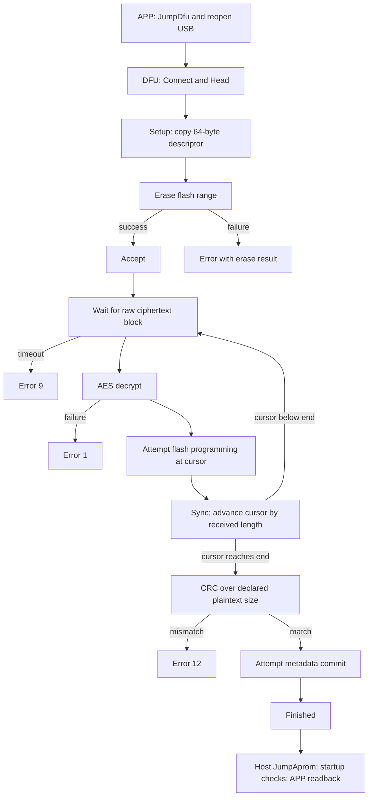

# Bootloader Logic

Device-side analysis of the bootloader acquired from KM003C hardware 2.1 while
the application reported firmware 1.9.9. The application version does not name
the bootloader's own version. Findings are limited to the acquired bytes.

The [updater documentation snapshot](updater_implementation.md) imports the
existing `km003c-rs/FIRMWARE.md` description of packages, catalog access, host
implementation, and previously completed hardware tests. This page adds the
bootloader's control flow, validation boundaries, register operations, and
instruction locations. No new device writes or update experiments were run
for this documentation pass.

## Inputs and Address Convention

The [partial bootloader binary](../../fw/bootloader_hw2.1_00000004-00003fff.bin)
contains 16,380 bytes mapped to runtime addresses `[0x4, 0x4000)`:

```text
SHA-256: 17d51eeff9fb6abe1a7024a108006248e0aaebdaae52de69a3e26c000565d4bf
binary file offset = bootloader runtime address - 4
```

The initial vector word at `[0,4)` is absent. No initial SP was invented or
prepended. The word at address `0x4` is reset vector `0x5d`, which enters Thumb
code at `0x5c`. All bootloader instruction addresses on this page are runtime
addresses; do not apply the application's `+0x4000` relocation to them.

The imported [acquisition record](evidence/bootloader_hw2.1/acquisition.json)
records two matching reads and independent prefix/boundary checks. Selected
[Ghidra exports and reproduction scripts](evidence/bootloader_hw2.1/README.md)
are preserved alongside a complete exported instruction listing. Decompiled C
contains inferred types and unresolved globals; instruction bytes and the
literal pools resolve ambiguities. The copied export represents the original
Ghidra 12.1.4 analysis, cross-checked against the binary during this pass.

## Reset, RAM Initialization, and Application Entry

At `0x5c–0x82`, startup unlocks `SRAMC.WTPR` / `SRAMC.CKPR`, sets SRAM wait
control, and relocks them. The startup table at `0x2a80` describes:

| Source | Destination | Length | Purpose |
|--------|-------------|--------|---------|
| Flash `0x2ab0` | SRAM `0x1fff8000` | `0x90` | Flash programming routine |
| Flash `0x2b40` | SRAM `0x1fff8090` | `0xb0` | Initialized data, including the AES key |
| Zero initialization | SRAM `0x1fff8140` | `0x37c8` | BSS, including USB buffers and state |

The startup helper at `0x48` installs SP `0x1fffb908`; this is an observed
instruction/literal, not recovery of the missing initial vector word.

The main initializer at `0x19d0` enables the pull-up on **PB7** through
`GPIO.PCRB7.PUU`, then reads `GPIO.PCRB7.PIN` using the bit-band aliases
`0x42a78b98` and `0x42a78ba0`. PB7 low bypasses the application-jump path.
Live GPIO reads identify PB7 as **Exit**, LQFP48 pad 43. Physical power-on
with Exit held entered DFU on HW2.1, and JumpAprom returned to the application.
See the [board bring-up evidence](board_bringup.md#verified-button-inputs-and-recovery).

With PB7 high, the application is entered only when:

| Check | Runtime instruction range |
|-------|---------------------------|
| Retention word at `0x200f0ff0` is not `0x12345678` | `0x19f4–0x19fc` |
| Application field at `0x4420` equals `0x4000` | `0x19fe–0x1a08` |
| Committed size at `0x4428` is at most `0x6fffe` | `0x1a0a–0x1a14` |
| Initial SP at `0x4000` is strictly between `0x1fff8000` and `0x20020000` | `0x1a16–0x1a2a` |

On success it writes `SCB.VTOR=0x4000`, loads MSP from `0x4000`, and calls
the reset pointer stored at `0x4004` (`0x1a2c–0x1a40`). This path does not
recompute the image CRC, compare model/version/date, or explicitly validate
the reset vector's Thumb bit and address range. Those additional vector checks
belong to the host updater. The SP window is also narrower than all of the
HC32F460's SRAM.

When the PB7-high path stays in the loader, it clears the retention word at
`0x1a42–0x1a44`. The PB7-low path jumps past that clear. The loader then
configures clocks, CRC/AES clocks, I2C3, AW9523B, graphics and USB, and repeatedly
calls the dispatcher at `0x12a8`. See [HC32F460 analysis](hc32f460_analysis.md)
for the corrected peripheral identities.

## USB Session and Dispatcher

The dispatcher first checks two USB-state bits in the object referenced by
`0x1fff811c`. It only dispatches a received message when USB state permits it.
Their precise USB meanings are not named here. A separate bit 2 is the
protocol-connected flag.

`0x1fffa4fc` is the receive buffer; `0x1fffb4fc` holds its received byte count.
The dispatcher consumes and clears that count, resets an idle counter, and
uses the first byte's low seven bits as command type. Before connection,
Connect `0x02` sets the connected flag and returns Accept; other commands are
rejected with code 4. Once connected, incoming type-byte bit 7 is rejected
with code 0. The optional payload-decryption branch at `0x132a–0x134c` is
separate from the raw update-block decryption loop.

The idle-disconnect path at `0x134e–0x1360` increments a polling counter and
eventually clears the connected flag. Its threshold is `0x044aa201`; this is
an iteration count, not an established wall-clock timeout.

### Replies

`0xfcc` constructs four-byte control replies using its own counter at
`0x1fff814c`, incremented once per reply. Host request IDs are not echoed.
The first not-yet-connected Connect path resets that counter to zero at
`0x131a` after sending its initial Accept, so it is not a globally monotonic
counter across connection initialization. Later replies use the current
device-owned value.
Error/rejection codes occupy wire bits 22 and up: using the canonical parsed
control header, `code = attribute >> 5`. `0xfc4` is the zero-code short-reply
wrapper.

The Head branch calls the MemoryRead-style response builder at `0xff4` with
constant arguments `(type=0x40, address=0, size=0, magic=0xffffffff, extra=0)`.
Its first zero field is not a dynamic readiness/progress indicator. The
captured twenty-byte response starts with type byte `0xc0`; its body is:

```text
00 00 00 00  00 00 00 00  ff ff ff ff  00 00 00 00
```

### Command Coverage

| Type | Observed dispatcher behavior | Evidence location |
|------|------------------------------|-------------------|
| `0x01` Sync | No-op when received as a framed command | Dispatcher switch |
| `0x02` Connect | Set connected flag; Accept | `0x1308`, `0x13b6` |
| `0x03` Disconnect | Clear connected flag; Accept | `0x1506–0x1516` |
| `0x04` Reset | Delay, set retention magic, system reset into loader | `0x15be–0x15d6` |
| `0x08` JumpAprom | Delay, clear retention magic, system reset | `0x15ca–0x15d6` |
| `0x40` Head | Constant MemoryRead-style response | `0x1388–0x1396`, `0xff4` |
| `0x42` Setup | Copy descriptor, erase, Accept, consume raw encrypted blocks, verify and commit | `0x13c2–0x147e`, `0x152e–0x1576` |
| `0x43` | Separate direct-program branch; rejects a start below `0x70000`, otherwise invokes the RAM writer and returns its code as Error | `0x1480–0x148c`, `0x151c–0x152c` |
| `0x44` MemoryRead | Framed confirmation followed by unframed AES ciphertext | `0x148e–0x149a`, `0xff4` |
| `0x46`, `0x47` | Graphics-related calls followed by Finished | `0x149c–0x14ba` |
| `0x4a` | Separate storage-write path with alignment/length checks and storage-driver calls | `0x14bc–0x14e0`, `0x1578–0x15bc` |
| `0x4b` | MemoryRead-style operation with `0x98000000` added to address; disabled by a storage-state flag | `0x14e2–0x14fa` |
| Other values | Rejected, code 3 | `0x1500–0x1504` |

JumpDfu `0x09` is an **application-side** transition into the loader, not an
accepted case in this loader's switch. The same distinction applies to
GetFile `0x0d`: it is not an implemented loader case in the acquired image.
Neither arbitrary ciphertext bytes nor the host packet-type enum establish
additional loader commands.

Both Reset and JumpAprom call `0x1110`, which writes AIRCR at `0xe000ed0c`
with `0x05fa0004` plus preserved priority-group bits. JumpAprom therefore
reboots and re-enters startup validation; it is not an unconditional branch
to application flash.

## Setup Descriptor and Transfer States

The existing host sends Head as `[0x40, id, 0x00, 0x01]` plus sixteen zero
bytes, and Setup as `[0x42, id, 0x00, 0x04]` plus this 64-byte descriptor.
All descriptor integers are little-endian.

| Body offset | Bytes | Meaning and consumption |
|-------------|-------|-------------------------|
| `0x00` | 4 | Start address; normal host enforces `0x4000` |
| `0x04` | 4 | End-exclusive; receive loop continues until cursor reaches/exceeds it |
| `0x08` | 4 | Plaintext size, independently used for CRC and metadata |
| `0x0c` | 4 | Expected plaintext CRC32 |
| `0x10` | 12 | Model text; first eight bytes are also copied during metadata commit |
| `0x1c` | 12 | Version text; no ordering comparison in this branch |
| `0x28` | 12 | Date text; no compatibility comparison in this branch |
| `0x34` | 4 | Host random value; not consumed by this update branch |
| `0x38` | 8 | Zero-filled by the host; not consumed by this update branch |



The receive loop is synchronous inside the Setup case. During it, incoming
bytes are treated as ciphertext rather than dispatched as framed commands.
There is no in-band abort command, block address, block sequence, or duplicate
detection in this loop. Ordinary host control messages cannot be interleaved
with update data.

## Erase Range and Actual Erase Extent

`0x13d4` calls `erase(start,end)` at `0x338`. Only after it returns zero does
`0x13e0` send Accept. The approximately one-second delay before Accept in
successful captures corresponds to this synchronous preparation phase.

The range helper at `0x278` takes `start` and `(end-start) >> 13`. It checks:

- Start must be four-byte aligned, otherwise return 2.
- Start must exceed `0x1fff`.
- `start + sector_count * 0x2000` must have no bits above bit 18.
- For the special start `0x2000`, that computed address must not exceed `0x4000`.

Other failed range checks return 3. This is not equivalent to a strict
`start == 0x4000`, `end == start + size` application policy, and does not
check all three descriptor fields for consistency. The production host adds
those checks. Treat the exact helper as loader behavior, not a recommended
range validator.

The erase routine unlocks EFM through `FAPRT` at `0x40010400` with `0x123`,
then `0x3210`, saves/disables the flash cache bit, enables erase mode 4 in
`EFM.FWMC`, and triggers each sector by writing `0x12345678` to its address.
It polls the EFM ready flag, checks `PEWERR`, and advances by `0x2000`.
It cleans up mode/protection and restores the saved cache setting on exit.

The loop runs while erase cursor is below `end`, so its effective sector
coverage extends past a non-sector-aligned end. For the normal aligned start:

```text
erase_end = start + ceil((end - start) / 0x2000) * 0x2000
```

The historical 453,828-byte image ends at `0x72cc4`, so erase touches sector
starts `0x4000` through `0x72000` and the last erased sector ends at `0x74000`.
The validated host limits the image to `0x6fffe` bytes; that is a host policy
derived from startup acceptance, not a size check made in Setup itself.

## Block Decryption, Programming, and Acknowledgment

At `0x1428`, `receive_wait` (`0x1618`) is called with a 20,000-iteration
deadline. The wait loop uses the firmware delay helper with argument 1,
returns the receive count, and clears it. This is the device's receive
deadline; the host's 2/20/5-second reply deadlines are separate policy.

At `0x143a`, AES decrypt (`0x120`) receives the raw block length, the common
key pointer `0x1fff810c`, and scratch destination `0x1fff8354`. Its key bytes
originate at flash `0x2bbc`. The helper requires nonzero pointers and length,
word-aligned pointers, and a length divisible by 16; it also has a bounded
AES polling loop. It uses the same AES-128-ECB memory-read key documented in
[Firmware Format](format.md#encryption).

The normal host sends 4,080-byte blocks, then an AES-aligned remainder. That
block size is host/capture evidence; it is not an explicit equality check in
the device's update loop. Every received block follows this sequence:

```text
decrypt(receive_buffer, received_length, key, scratch)
program_from_ram(cursor, cursor + received_length, scratch)
send Sync
cursor += received_length
```

The flash writer's return value at `0x144c` is **not checked** before Sync at
`0x1452`. The cursor advances by the received length rather than a declared
plaintext remainder. Consequently a final block may program AES padding after
the logical image end. Completion is `cursor >= end`; the CRC covers exactly
the independently declared plaintext size.

Repeating a block after a lost Sync can put its data at the next cursor.
The updater therefore sends Setup and each data block once and aborts the
host-side attempt when acknowledgment is missing. Retrying the whole update
is distinct from replaying one block; deliberate loss/recovery was not tested
on hardware.

### RAM Flash Writer

The thunk at `0x3f0` branches to Thumb pointer `0x1fff8001`. Runtime
`0x1fff8000–0x1fff808f` is copied from flash `0x2ab0–0x2b3f` at startup.
Its [exported body](evidence/bootloader_hw2.1/1fff8000.c) shows:

1. Check only the first destination word is `0xffffffff`; return 1 if not.
2. Unlock EFM, preserve/disable cache, enter programming mode 3, and clear flags.
3. While destination is below end, copy a 32-bit source word, wait for
   `EFM.FSR.OPTEND` (bit 4), clear that flag, and advance by four bytes.
4. Leave programming mode, wait for `RDY` (bit 8), restore cache/protection,
   and return zero.

This routine does not independently compare programmed bytes against the
source. Its hardware polling loops do not have software timeouts. The update
branch ignores both its per-block return and its later metadata-write return.
Sync and Finished therefore describe control-flow completion, not independently
verified per-write flash contents.

## CRC and Metadata Commit

After the cursor reaches the end, `0x1534` calls checksum routine `0x125c`
with the descriptor's original start and plaintext size. It seeds `CRC.RESLT`
at `0x40008c04` with `0xffffffff`, feeds full words and remaining bytes through
the CRC data register, and compares the result against the expected CRC.
Successful captured uploads match host CRC-32/ISO-HDLC calculations.

On CRC match, `0x153e–0x154c` calls the RAM writer with:

```text
destination = start + 0x428
end         = start + 0x436
source      = descriptor + 0x08
```

The 14-byte end distance causes **four 32-bit writes**, covering 16 bytes:

| Image offset | Written value |
|--------------|---------------|
| `0x428–0x42b` | Declared plaintext size |
| `0x42c–0x42f` | Upload CRC32 |
| `0x430–0x437` | First eight descriptor-model bytes |

The valid input image has erased size/CRC placeholders and matching embedded
model bytes. The upload CRC is checked **before** this patch and is not
recomputed afterward. The installed flash therefore differs from the original
plaintext upload, and its whole-image CRC need not equal the upload CRC.

For the captured 453,828-byte September 2025 image, the predicted bytes at
runtime `0x4428` were:

```text
c4 ec 06 00  4e b5 80 7c  4b 4d 30 30 33 43 00 00
size         CRC           KM003C
```

A previously acquired metadata read independently matched this prediction;
the [copied check record](evidence/bootloader_hw2.1/metadata_patch_check.json)
preserves that narrow observation. The later full hardware cycle also verified
the complete final installed image. Its results supersede the older check
record's statement that whole-image readback had not yet been acquired.

The metadata writer return is ignored before Finished (`0x1552`). A final
readback is thus needed even after a successful pre-commit CRC. The host's
`installed_data()` constructs these expected patched bytes and compares them
after reboot. It does not simply compare version strings.

## Errors and Remaining Validation Boundaries

| Reply | Code | Confirmed cause in the inspected path |
|-------|------|--------------------------------------|
| Reject `0x06` | 0 | Incoming command type byte has bit 7 set |
| Reject `0x06` | 1 | Optional framed payload decryption failed |
| Reject `0x06` | 3 | Unsupported command |
| Reject `0x06` | 4 | Command before Connect |
| Error `0x0b` | Erase return | Setup erase failed; range helper returns 2 or 3, erase operation may return 1 |
| Error `0x0b` | 1 | Update-block AES decryption failed |
| Error `0x0b` | 9 | Timed out waiting for update data |
| Error `0x0b` | 12 | Final plaintext CRC mismatch |

No version-order comparison or digital-signature verification appears in this
Setup branch or its called validation path. Model/version/date compatibility
is not validated by this branch. The normal host validates package metadata,
vectors, base/end/length consistency, ciphertext, model, and committed-byte
expectations. This documents the inspected code; it does not establish
acceptance of arbitrary modified firmware on hardware.

Uncommitted erased size `0xffffffff` fails the startup size bound, which
explains a possible loader fallback after an incomplete update. However, the
startup path does not verify CRC, and metadata is programmed as multiple words.
Power-loss recovery at all erase/program/commit points remains untested; it
must not be described as an atomic or guaranteed recovery mechanism.

The MemoryRead handler at `0xff4` also ignores the AES encrypt helper's return.
The AES helper rejects source pointer zero, so that loader path can send
unchanged scratch-buffer data for a zero-address request. This is specific
code evidence for this loader. The failed initial acquisitions occurred in
application mode; a shared cause there must be traced separately.

## Captures and Previously Completed Hardware Tests

The copied [historical capture summary](evidence/bootloader_hw2.1/historical_update_capture.json)
identifies a successful official `1.9.7 -> 1.9.9` update in the existing master
dataset. In `updating_firmware.8`:

| Event | Capture frame |
|-------|---------------|
| Connect | 3859 |
| Head request / response | 5563 / 5565 |
| Setup / post-erase Accept | 5567 / 5665 |
| First / last ciphertext block | 5669 / 6217 |
| Finished | 6223 |
| JumpAprom | 6285 |

That upload has 111 blocks of 4,080 bytes and one of 960 bytes: 453,840 bytes
of ciphertext, including 12 padding bytes beyond 453,828 plaintext bytes.
All 112 stop-and-wait Sync replies were correlated. Some open questions in
that historical JSON were subsequently resolved by the static analysis above;
the JSON preserves its original observation time rather than current gap status.

The [hardware-cycle summary](evidence/bootloader_hw2.1/hardware_cycle_summary.json)
and [frame/timing summary](evidence/bootloader_hw2.1/hardware_capture_summary.json)
were imported from the existing 2026-10-28 test artifacts:

| Transition | Setup / Accept / Finished frames | Setup-to-Finished | Result |
|------------|----------------------------------|-------------------|--------|
| Original 1.9.9 -> 2.0.7 | 1532 / 1537 / 16099 | 3.499521 s | 112 Sync, Finished, reboot, full readback matched |
| 2.0.7 -> exact original 1.9.9 | 1540 / 1545 / 16011 | 3.490940 s | 112 Sync, Finished, reboot, full readback matched |

These frame numbers belong respectively to `upgrade-attempt1.pcapng` and
`downgrade-attempt1.pcapng`, not the master dataset's historical capture.
Raw cycle captures remain in the original local diagnostic directory;
only their summaries are copied here.

During this documentation pass, the copied binary and RAM-code mapping were
checked against all 3,692 exported instruction locations, including 362 direct
branch targets. Eleven historical control-frame payloads were matched against
the master dataset. The original/final application and final loader readback
files were also compared offline again. AES-aligned readback files contain
12 and 4 extra trailing bytes respectively; comparisons use only the declared
application and acquired-loader extents. These checks are recorded in
[verification.json](evidence/bootloader_hw2.1/verification.json).

The independent final read matched all 453,828 original application bytes,
SHA-256 `1917eb2f05fb848c4f98323d17cbd6eacc3252dfc0f16bb479f8564e0311417a`.
The entire acquired 16,380-byte bootloader extent matched the copied dump.
Device identity/authentication information matched, and `info` / ADC commands
worked after both transitions. This is not an accuracy test of ADC values.

The captured 453,828-byte image is **different** from this repository's older
453,616-byte padded `fw/KM003C_V1.9.9_key0_ecb.bin` despite sharing the version
string. Do not use offsets, plaintext lengths or image hashes interchangeably.

Still open: the missing initial SP word, interrupted-update recovery, deliberate
ACK-loss behavior on hardware, other board/loader
revisions, and release-by-release compatibility.

## Fault and disconnect limits

The HardFault vector points to `0x460` (Thumb pointer `0x461`). Its handler
prints `Enter HardFault_Handler, System Halt.` over USART3 and loops forever.
It does not reboot into recovery. ICG0 at `0x400` is `0xffffffff`; ICG1 at
`0x404` is `0xff03ffff`. The vendor's WDTAUTS/SWDTAUTS encoding selects stopped
watchdogs after reset. No loader watchdog enable/feed sequence was identified.
Consequently an unbounded EFM-ready poll or HardFault cannot rely on an
inherited watchdog to recover automatically.

The USB send wrapper at `0x738` waits up to 1000 delay iterations and returns
`-7`; callers ignore that result. The synchronous receive loop does not abort
immediately on loss of the main loop's connected flag. A disconnect can therefore
lead to a receive timeout, a failed error reply, and eventual return to the
main dispatcher rather than automatic reset or rollback. Delay-loop frequency
constants do not establish precise wall-clock timeouts.

Selected additional decompilations are preserved in
[the bring-up evidence](evidence/hw2.1_bringup/README.md). The separate
[Rust smoke test](evidence/rust_smoke_hw2.1/README.md) verifies normal application
replacement and explicit return-to-loader, not power-loss safety or ACK-loss
recovery during an interrupted flash operation.
